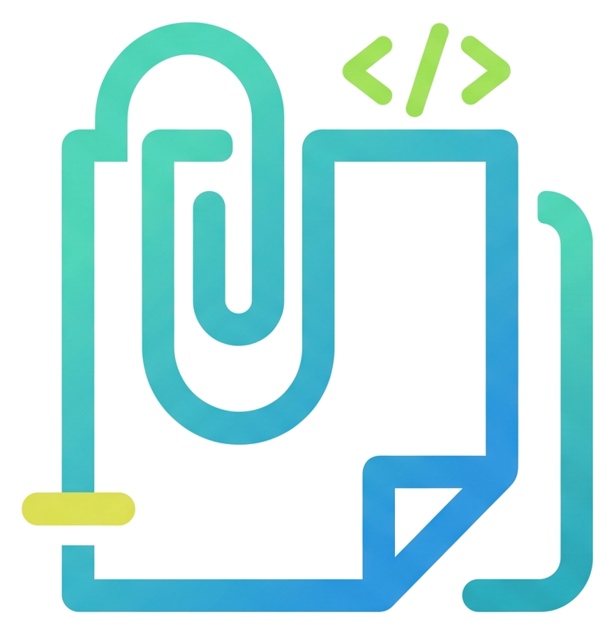

# 📋 ClipDev

<div align="center">
  
  <h3>Gestor inteligente de portapapeles y notas para desarrolladores</h3>
  <p>Rápido, privado, 100% offline y diseñado a medida para Windows.</p>

  [](https://www.electronjs.org/)
  [](https://react.dev/)
  [](https://www.typescriptlang.org/)
  [](https://tailwindcss.com/)
  [](https://www.sqlite.org/)
  [](https://vitejs.dev/)
  [](LICENSE)
</div>

---

> ### 🚀 ¿Quieres probar ClipDev sin instalar nada ni usar la consola?
> Si solo quieres usar la aplicación como usuario final, **no necesitas clonar el repositorio ni usar Node.js**.
> 
> Dirígete a la sección de **[Releases (Versiones Publicadas)](https://github.com/NicoVillarroelM/clipDev/releases)** en GitHub y descarga directamente el archivo ejecutable:
> * **`ClipDev 1.0.3.exe` (Portable):** Descarga y haz doble clic para usar de inmediato sin instalar.
> * **`ClipDev Setup 1.0.3.exe` (Instalador):** Crea accesos directos en el Escritorio y Menú Inicio.

---

## 🌟 Características Principales

### 1. 📋 Portapapeles Inteligente
* **Monitoreo en segundo plano (0% CPU en reposo):** Detecta automáticamente cualquier texto o imagen copiada mediante verificación nativa de formatos y comparación de hashes MD5 sobre buffers crudos.
* **Detección semántica de contenido:** Identifica automáticamente si lo copiado es:
  * 💻 **Código o comandos de terminal** (JavaScript, TypeScript, HTML, SQL, Git, Docker, etc.).
  * 🔗 **Enlaces y URLs** (con acceso directo para abrirlos con un clic en tu navegador seguro).
  * 🎨 **Colores** (códigos Hexadecimales y RGB con vista previa en miniatura en tiempo real).
  * 🖼️ **Imágenes** (capturas o imágenes del portapapeles con compresión inteligente, resolución y visor modal).
  * 📝 **Texto general**.
* **Fijado prioritario (Pin):** Mantén tus fragmentos más importantes en la parte superior.
* **Buscador en tiempo real y filtros:** Encuentra rápidamente cualquier fragmento copiado por tipo o palabra clave.
* **Modal de inspección:** Revisa textos y bloques de código extensos con resaltado y formato limpio.
* **Limpieza rápida:** Borra clips antiguos manteniendo tus elementos fijados protegidos.

### 2. 📝 Bloc de Notas con Formato Enriquecido
* **Editor WYSIWYG completo:** Escribe notas rápidas con soporte para:
  * **Tipografía:** Negrita (`Ctrl+B`), Cursiva (`Ctrl+I`), Subrayado con color de acento (`Ctrl+U`), Tachado y Resaltador.
  * **Estructura:** Encabezados (`H1`, `H2`), Párrafos (`P`), Listas con viñetas y Listas numeradas.
  * **Bloques técnicos:** Citas (`Blockquote`) y Bloques de código preformateados (`Pre / Code`).
  * **Historial y limpieza:** Deshacer (`Undo`), Rehacer (`Redo`) y Quitar formato.
* **Soporte avanzado de imágenes:** Pegado directo de imágenes desde el portapapeles, toolbar flotante con redimensionamiento rápido (25%, 50%, 75%, 100%), control de alineación y ajuste interactivo por arrastre.
* **Pegado inteligente:** Conserva el formato enriquecido al pegar desde Word, Google Docs o sitios web, y mantiene la sangría en bloques de código.
* **Organización por colores:** Asigna etiquetas visuales a tus notas (Ámbar, Esmeralda, Azul, Púrpura, Rosa o Neutro).
* **Métricas en vivo:** Contador de caracteres y palabras en tiempo real.

### 3. 🔒 100% Privado, Local y Motor SQLite Nativo
* **Sin cuentas ni inicio de sesión:** No requiere internet ni sincronización con la nube. Toda tu información te pertenece y se queda en tu equipo.
* **Base de datos SQLite integrada (`node:sqlite`):** Tus clips y notas se almacenan en una base de datos relacional local (`clipdev.db`) con modo **`WAL` (Write-Ahead Logging)** y **`auto_vacuum = FULL`**, logrando transacciones ultrarrápidas, cero corrupción ante cierres inesperados y compactación automática del espacio en disco.
* **Almacenamiento binario (`BLOB`) y sincronización diferencial:** Las imágenes se guardan como bytes binarios puros en lugar de cadenas Base64 pesadas, y solo se actualizan en disco las filas modificadas (`INSERT` / `UPDATE` / `DELETE`).

### 4. ⌨️ Acceso Rápido Global
* Presiona **`Ctrl + Shift + V`** desde cualquier ventana o juego en Windows para mostrar u ocultar ClipDev al instante.

### 5. 🎨 Personalización y Accesibilidad
* **Temas Claro y Oscuro** con contraste de alta legibilidad.
* **Acabado de ventana personalizable:** Alterna entre interfaz sólida clásica o acabado acrílico/translúcido (`Glass`).
* **6 Paletas de color de acento:** Ámbar, Esmeralda, Cian, Azul, Violeta y Rosa.
* **Escala de interfaz ajustable:** Soporte para tamaño Normal (100%), Grande (112%) y Muy Grande (125%) para facilitar la lectura.
* **Bilingüe:** Interfaz completa en **Español** e **Inglés** intercambiable con un solo clic.

---

## 🛡️ Seguridad Endurecida

ClipDev sigue las directrices oficiales de seguridad de Electron:
* **Context Isolation:** Habilitado para aislar el proceso de renderizado del entorno de ejecución de Node.js.
* **Sandbox:** Activado (`sandbox: true`) para máxima protección del sistema anfitrión.
* **Node Integration Desactivado:** El renderizador nunca tiene acceso directo al sistema operativo.
* **Política de Seguridad de Contenido (CSP):** Reglas estrictas aplicadas en `index.html`.
* **Manejo seguro de enlaces:** Se impiden navegaciones internas y ventanas emergentes; los enlaces web se abren únicamente a través de `shell.openExternal`.
* **Denegación de permisos:** Permisos sensibles (cámara, micrófono, geolocalización) bloqueados por defecto.

---

## 🚀 Instalación y Ejecución

### Requisitos previos
* [Node.js](https://nodejs.org/) (versión 20 o superior)
* [pnpm](https://pnpm.io/) (versión 9 o superior recomendada)

### Instalación de dependencias
```bash
pnpm install
```

### Ejecutar en modo desarrollo
Inicia Vite y Electron simultáneamente con recarga en vivo (HMR):
```bash
pnpm run dev
```

---

## 📦 Generación de Ejecutables para Windows

Para usar ClipDev de forma independiente sin abrir terminales ni servidores:

| Comando | Descripción | Archivo resultante |
| :--- | :--- | :--- |
| `pnpm run dist:dir` | **Desempaquetado (Arranque instantáneo)** | `release/win-unpacked/ClipDev.exe` |
| `pnpm run dist:portable` | **Portable (Ejecutable único sin instalar)** | `release/ClipDev 1.0.4.exe` |
| `pnpm run dist` | **Instalador estándar de Windows (NSIS)** | `release/ClipDev Setup 1.0.4.exe` |

> **Tip de rendimiento:** Para un arranque instantáneo (en menos de 1 segundo), ejecuta directamente `release/win-unpacked/ClipDev.exe` o créale un acceso directo en tu Escritorio.

---

## 📁 Estructura del Proyecto

```text
clipDev/
├── electron/
│   ├── database/            # Motor de base de datos SQLite nativo (node:sqlite)
│   │   ├── index.ts         # Clase principal ClipDevDatabase y transacciones
│   │   ├── mappers.ts       # Transformadores Base64 <-> BLOB y mapeo de filas
│   │   ├── migrator.ts      # Migración automática desde clips.json y notes.json
│   │   ├── schema.ts        # PRAGMAs (WAL, auto_vacuum) y consultas SQL preparadas
│   │   └── types.ts         # Interfaces tipadas del modelo de persistencia
│   ├── main.ts              # Proceso principal de Electron, atajos globales y monitoreo de portapapeles
│   └── preload.ts           # Puente seguro IPC expuesto a React (ContextBridge)
├── public/
│   ├── clipDev_logo.ico     # Icono nativo de Windows (multi-resolución)
│   └── clipDev_logo.png     # Favicon público
├── src/
│   ├── assets/              # Recursos gráficos optimizados del frontend
│   ├── constants/           # Capa centralizada de constantes de aplicación
│   │   ├── app.ts           # Versión, límites, timeouts y claves de almacenamiento
│   │   ├── filters.ts       # Configuración de filtros del portapapeles
│   │   ├── notes.ts         # Paleta de notas y presets de redimensión de imagen
│   │   ├── settings.ts      # Opciones de escala e idiomas
│   │   └── index.ts         # Exportador unificado de constantes
│   ├── hooks/               # Custom hooks de lógica y estado desacoplado
│   │   ├── useAppearance.ts # Tema, modo, acabado translúcido, zoom y notificaciones
│   │   ├── useClips.ts      # Historial de portapapeles, IPC, filtros y búsqueda
│   │   ├── useNotes.ts      # Persistencia y gestión de notas
│   │   ├── useNoteImageEditor.ts # Selección, alineación y redimensión de imágenes
│   │   └── index.ts         # Exportador unificado de hooks
│   ├── components/          # Componentes organizados por dominio
│   │   ├── clips/           # Módulo del portapapeles
│   │   │   ├── ClipBadge.tsx      # Insignia semántica de tipo de clip
│   │   │   ├── ClipCard.tsx       # Tarjeta individual con acciones
│   │   │   ├── ClipModal.tsx      # Modal detallado para código o imágenes
│   │   │   ├── ClipSkeleton.tsx   # Esqueleto de carga fluido
│   │   │   ├── FilterBar.tsx      # Barra de búsqueda y filtros
│   │   │   └── index.ts
│   │   ├── notes/           # Módulo del editor de notas
│   │   │   ├── NoteSidebar.tsx    # Barra lateral de lista y creación
│   │   │   ├── NoteHeader.tsx     # Título, color, copia y eliminación
│   │   │   ├── NoteFormatToolbar.tsx # Barra de formato de texto enriquecido
│   │   │   ├── NoteImageToolbar.tsx  # Toolbar flotante de imágenes
│   │   │   ├── NoteFooter.tsx     # Estado de disco y conteo de palabras
│   │   │   ├── NotesView.tsx      # Orquestador del bloc de notas
│   │   │   └── index.ts
│   │   ├── layout/          # Ventana y controles estructurales
│   │   │   ├── TitleBar.tsx       # Barra de título arrastrable y pestañas
│   │   │   ├── ScaleToast.tsx     # Alerta flotante de nivel de zoom
│   │   │   └── index.ts
│   │   ├── settings/        # Preferencias y apariencia
│   │   │   ├── SettingsPopover.tsx# Menú popover de ajustes y updates
│   │   │   ├── ThemeSelector.tsx  # Selector visual de paletas
│   │   │   └── index.ts
│   │   ├── modals/          # Diálogos modales
│   │   │   ├── ConfirmDeleteModal.tsx # Confirmación de eliminación y vaciado
│   │   │   └── index.ts
│   │   └── index.ts         # Barrel export maestro de componentes
│   ├── locales/
│   │   └── translations.ts  # Textos y traducciones completas en ES y EN
│   ├── types/
│   │   ├── clip.ts          # Interfaces de Clips y Notas
│   │   ├── electron.d.ts    # Tipado seguro para window.electronAPI
│   │   └── theme.ts         # Tipado de temas, modos y escalas
│   ├── utils/
│   │   └── detector.ts      # Detección heurística de código, URLs, colores e imágenes
│   ├── App.css              # Variables CSS de temas, efectos translúcidos y estilos
│   ├── App.tsx              # Orquestador ligero de vistas y estado global
│   └── main.tsx             # Punto de entrada de React con ErrorBoundary
├── index.html               # Plantilla HTML base con CSP estricto
├── package.json             # Scripts y configuración de empaquetado
├── tsconfig.json            # Configuración estricta de TypeScript
└── vite.config.ts           # Configuración de Vite con plugins de Electron y Tailwind
```

---

## 💾 Dónde se almacenan tus datos

Toda la información se guarda de forma persistente y privada en tu usuario de Windows mediante una única base de datos SQLite:

```text
%APPDATA%\clipDev\
└── clipdev.db   # Base de datos SQLite (tablas clips y notes + imágenes en BLOB binario)
```

> **Migración automática:** Si vienes de una versión anterior que usaba `clips.json` y `notes.json`, ClipDev migra tus datos automáticamente a `clipdev.db` al abrir la aplicación y limpia los archivos antiguos. Puedes respaldar o copiar `clipdev.db` en cualquier momento para llevar tus datos a otro equipo.

---

## 📄 Licencia

Este proyecto está bajo la Licencia **MIT**. Consulta el archivo `LICENSE` para más detalles.
